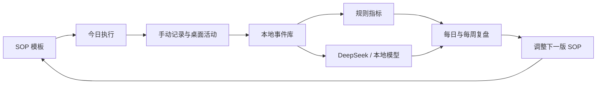

# SOP Loop 产品设计蓝图

版本：0.1 设计稿

## 一句话定位

SOP Loop 是一个本地优先的个人执行与复盘系统：用户把重复性目标写成 SOP，软件记录执行过程和结果，帮助用户用数据调整下一版 SOP。

它不是普通日记、待办事项或聊天机器人。核心价值是把“计划、执行、证据、复盘、改进”连成一个闭环。

## 设计判断

当前市场上已有很多单点工具：

- [ActivityWatch](https://github.com/ActivityWatch/activitywatch) 擅长本地桌面活动追踪。
- [Super Productivity](https://github.com/super-productivity/super-productivity) 擅长任务、时间块和时间追踪。
- [Logseq](https://github.com/logseq/logseq)、[Joplin](https://github.com/laurent22/joplin) 和 [jrnl](https://github.com/jrnl-org/jrnl) 擅长本地记录。
- [Ollama](https://github.com/ollama/ollama) 和 [Open WebUI](https://github.com/open-webui/open-webui) 擅长连接本地或远程模型。

这些工具可以作为参考或集成对象，但在本次检索范围内，没有看到一个成熟项目把 SOP 版本、执行证据、每日复盘和 AI 改进建议放进同一个闭环。因此产品的差异点应放在“行为改进流程”，而不是“再做一个 AI 日记”。

## 核心用户流程



### 早上：计划

用户看到今日的 1 到 3 个重点 SOP，而不是一张无限任务清单。每个 SOP 显示预计时长、今天的目标和上一次执行的阻碍。

### 白天：执行

用户可以手动开始一个 SOP，也可以只记录关键节点。桌面端可在用户授权后记录当前应用、窗口类别、活动时长和空闲时间。默认只保存类别和时长，不记录键盘内容、屏幕画面或网页正文。

### 晚上：复盘

复盘控制在 3 到 5 分钟内。软件优先询问数据中缺失的部分：计划用了 60 分钟，实际用了 110 分钟，就询问多出来的时间用于什么，而不是让用户重新写一篇日记。

### 每周：改进

系统对比 SOP 版本，展示哪些变化有效，哪些只是增加了复杂度。用户确认后，才把建议保存成下一版 SOP。

## 跨端产品形态

### macOS 和 Windows：完整工作台

桌面端是产品的主工作区，承担：

- SOP 编辑、版本管理和模板复用
- 今日计划、计时和执行状态
- 可选的应用与空闲活动采集
- 每日、每周、月度分析
- AI 分析和数据导出
- 菜单栏或系统托盘快速记录

桌面端可以在后台运行，但必须有清晰的采集状态、暂停按钮和权限说明。采集功能应当逐项授权，而不是一次性获得所有权限。

### Android：快速记录和复盘入口

Android 端重点放在高频、低摩擦的场景：

- 一键开始或结束 SOP
- 快速添加阻碍、想法和结果
- 每日复盘提醒
- 查看今日进度和最近趋势
- 语音转文字后再由 AI 整理
- 离线记录，联网后同步

Android 系统对后台活动采集有限制，因此第一版不把“持续监控手机上的所有应用”作为核心承诺。可以先使用手动记录、Android Usage Stats（用户明确授权时）和通知提醒。

### 多端同步

第一阶段支持本地数据库、加密备份和 JSON/CSV 导出。第二阶段再加入多端同步：

1. 每个事件使用全局唯一 ID 和设备 ID。
2. 本地先写入，后台再同步。
3. 同步只传输加密数据块，不把 DeepSeek Key 放到服务器。
4. 同一条复盘出现冲突时保留两个版本，交给用户合并。

这样即使同步服务不可用，软件仍然可以完整工作。

## 信息架构

主导航保持五项：

1. **今天**：今日 SOP、执行状态、快速记录。
2. **SOP**：模板、版本、步骤和完成标准。
3. **时间线**：按时间查看事件、复盘和阻碍。
4. **分析**：趋势、偏差、模式和实验结果。
5. **设置**：数据、同步、模型、权限和导出。

### 今天页面

今天页面是默认首页，结构从上到下为：

- 今日一句话目标
- 进行中的 SOP
- 今日执行时间与计划偏差
- 需要补充的两三个记录
- 晚间复盘入口

它不使用高密度仪表盘，而是让用户立即知道“现在做什么”和“今天还缺哪条信息”。

### SOP 页面

每个 SOP 包含：

- 名称、用途和适用场景
- 步骤列表
- 预计时长和完成标准
- 必填记录项
- 常见阻碍
- 当前版本与历史版本
- 最近执行结果

SOP 需要支持“复制为新版本”，不能直接覆盖历史数据。否则无法判断改动是否带来了改善。

### 分析页面

分析分为三个层级：

- **事实**：实际时长、完成率、偏差、打断次数。
- **模式**：哪些时间段、环境或前置条件与结果相关。
- **实验**：用户修改 SOP 后，结果是否改善。

每条 AI 洞察都必须显示证据范围、样本量和置信程度，并允许用户标记“有帮助”“不准确”或“暂时忽略”。

## 数据模型

核心实体建议保持简单：

```text
Workspace
  ├─ Device
  ├─ SOP
  │    ├─ SOPVersion
  │    └─ SOPStep
  ├─ SOPRun
  │    └─ StepRun
  ├─ Event
  ├─ DailyReview
  ├─ Insight
  └─ Experiment
```

### SOP

保存流程定义，不保存某一天的执行结果。

### SOPRun

代表某一天的一次执行，包含开始时间、结束时间、完成状态、偏差原因和用户备注。

### Event

保存活动来源、时间、分类、时长、置信度和设备。来源可以是手动记录、桌面采集、计时器、日历或外部导入。

### DailyReview

保存当天的结果、精力、阻碍、收获和明日调整。情绪字段可以是用户自填，不应由软件擅自推断。

### Insight

保存分析结论、证据引用、生成模型、生成时间和用户反馈，避免每次打开页面都重新生成一套互相矛盾的结论。

## 技术方向

首选方案是：

- **客户端壳**：Tauri 2，桌面和 Android 共用一套前端界面。
- **界面**：React + TypeScript，响应式布局，中文和英文从第一天支持。
- **本地数据**：SQLite，使用迁移机制管理版本。
- **业务层**：Rust 负责本地数据、事件处理、同步和权限边界。
- **模型网关**：统一的 Provider 接口，支持 DeepSeek、OpenAI 兼容接口、Ollama 和 LM Studio。
- **凭据存储**：macOS Keychain、Windows Credential Manager、Android Keystore。

Tauri 适合本地优先桌面软件，安装包和内存占用通常比 Electron 更克制。桌面活动采集、Android Usage Stats 和通知仍需要各平台原生适配层，不能假设一套 JavaScript API 在三端完全相同。

如果后期发现 Android 端需要更深的系统能力，可以保留同一套 Rust 数据协议，再把 Android 外壳替换为 Kotlin/Jetpack Compose，而不改变核心数据模型。

## DeepSeek 与 AI 层设计

模型不应直接操作数据库，也不应直接修改 SOP。建议采用三步：

1. 本地规则引擎先计算统计结果。
2. 本地生成脱敏摘要和证据片段。
3. 模型只返回结构化分析，用户确认后才写入 Insight 或新的 SOP 版本。

AI 功能分为：

- 复盘整理：把短句、计时和事件整理成当天总结。
- 阻碍归类：把重复出现的问题归入环境、任务拆分、时间安排等类别。
- 趋势解释：解释实际数据发生了什么，不直接下心理诊断。
- 追问：只针对缺失数据提问。
- 改进实验：提出一个可在 7 天内验证的 SOP 改动。

设置页应显示当前 Provider、接口地址、模型、最近请求时间、Token 用量和费用估计。API Key 只能保存到系统密钥存储中，默认不上传原始时间线。

## 视觉与交互方向

设计读法：这是一个面向长期使用的个人生产力工具，应该安静、可信、偏编辑器和工作台，而不是炫技式 AI 仪表盘。

- 基础色：冷白、石墨黑和灰蓝。
- 唯一强调色：低饱和的青绿色，用于“进行中”和可确认的改进。
- 字体：现代无衬线，中文使用系统字体，英文可使用 Geist 或系统无衬线。
- 形状：中等圆角，控件和卡片保持同一套圆角规则。
- 动效：只用于状态转换、完成反馈和时间线展开，支持减少动态效果。
- 密度：桌面端中等密度，手机端优先显示一件事和一个动作。

避免使用紫色 AI 渐变、满屏玻璃卡片、无证据的评分和过多徽章。行为分析应该通过趋势、对比和证据呈现，而不是用一个“你的效率是 87 分”的数字代替解释。

## MVP 范围

第一版只做以下内容：

1. SOP 创建、步骤和版本复制。
2. 今日执行和计时。
3. 手动事件和每日复盘。
4. SQLite 本地存储、导出和加密备份。
5. 基础统计：计划时长、实际时长、完成率、偏差原因。
6. DeepSeek API 配置和结构化复盘摘要。
7. macOS、Windows、Android 的基础同步协议，但先不承诺复杂的云同步。

第一版暂时不做：

- 全量屏幕录制或键盘记录。
- 自动判断情绪或心理状态。
- 自动给用户打综合效率分。
- 十几个外部服务集成。
- 复杂社交、排行榜和团队协作。

## 最重要的验证指标

产品是否成功，不应先看 AI 生成了多少字，而应看：

- 用户是否连续 7 天完成至少一次复盘。
- 用户是否能在 30 秒内开始一次 SOP。
- 一周后，用户是否主动修改过至少一个 SOP。
- 修改后的 SOP 是否降低了实际时长偏差或重复阻碍。
- 用户是否知道哪些数据被采集、保存在哪里、何时上传。

下一步建议先做三个可评审的低保真页面：**今天、SOP 详情、每日复盘**。这三页确认之后，再决定具体技术栈和桌面活动采集的权限范围。
